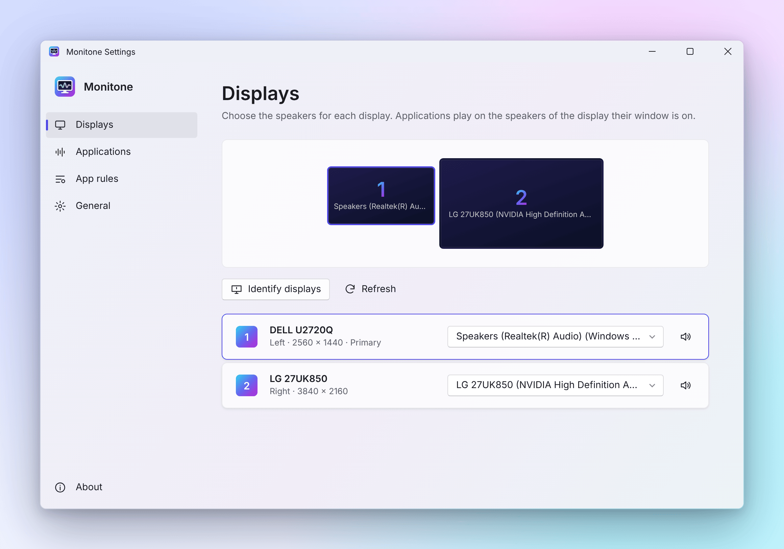
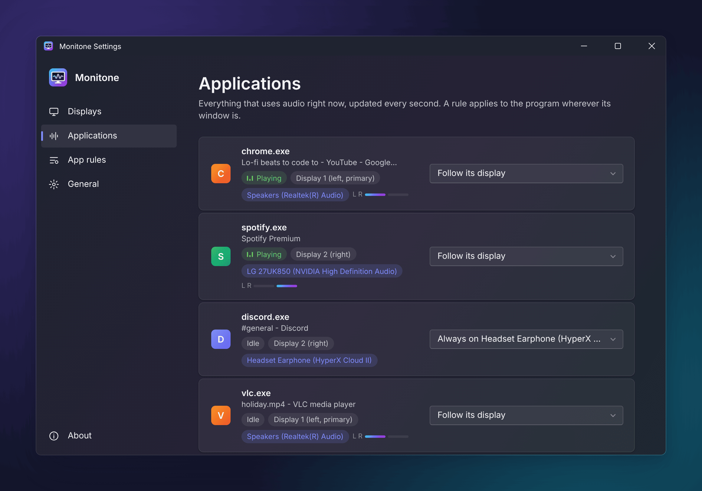

# Monitone

Every program plays on the speakers of the screen it is on.

Move a video from your left screen to your right screen, and the sound moves
from the left speakers to the right speakers. Monitone runs quietly in the
notification area and does this for you, for every program.

  

## What you need

- Windows 10 or Windows 11
- Speakers for your screens: either separate speakers per screen (for example
  USB speakers, monitor speakers or a second sound card), or one stereo or
  surround set that you want to split left and right
- The Microsoft Edge WebView2 Runtime for the settings window. It is part of
  Windows 11 and already installed on almost every Windows 10 PC. If it is
  missing, Monitone shows you where to get it.

## Installation

1. Download the latest `Monitone-x.y.z-x64.zip` from the
   [Releases page](https://github.com/Nusi42/Monitone/releases).
2. Unpack it into a folder of your choice, for example
   `C:\Users\<you>\AppData\Local\Programs\Monitone`. Keep `Monitone.exe` and
   `MonitoneSettings.dll` together in the same folder.
3. Start `Monitone.exe`. The Monitone icon, a screen with a sound wave,
   appears in the notification area next to the clock. If you don't see it,
   click the small arrow there to show hidden icons.

## First steps

1. Double-click the Monitone icon to open the settings.
2. On the **Displays** page, choose the speakers for each screen. Click
   *Identify displays* if you are not sure which screen is which.
3. Click the speaker button next to a screen to hear a short test beep on its
   speakers.
4. On the **General** page, turn on *Start with Windows* so Monitone is always
   there.

That's it. Every change takes effect immediately; there is nothing to save.

## One speaker set, left and right

If you have one pair of speakers and want "left screen = left speaker", open
the **General** page and choose a *Balance* mode:

- **By display**: programs on the left screen play on the left speaker,
  programs on the right screen on the right speaker.
- **By window**: the sound follows the window smoothly from left to right,
  even while you drag it.

Only the program itself is panned; everything else keeps playing normally.

## The settings window

  

- **Displays**: your screens as they are arranged, and the speakers for each.
- **Applications**: everything that is playing sound right now, which screen it
  is on and where it plays. You can give a program a rule right here.
- **App rules**: rules for programs that should not follow their screen. For
  example *Always on Headset* for your voice chat, or *Exclude* for a program
  Monitone should never touch.
- **General**: balance, pause, start with Windows, and a few more options.
- **About**: version and license.

Right-click the Monitone icon for quick access: settings, speakers per
screen, balance, pause and exit. While paused, the icon turns grey.

## Good to know

- Most programs switch speakers immediately: browsers, Spotify, VLC, media
  players, games. A few only switch when you stop and start playback.
- Programs that are set to one fixed output device in their own settings (for
  example music production software) are not moved. Set them to the Windows
  default device if you want Monitone to move them.
- If a program has windows on two screens, the window you are using decides.
  Windows treats all sound of one program as a single stream.
- When you exit Monitone, it puts every program back on the Windows default
  speakers. You can turn this off on the **General** page.
- The settings window is only loaded while it is open, so in the background
  Monitone uses very little memory.
- Your settings are stored in `%APPDATA%\Monitone\Monitone.ini`. Copy that
  file to keep a backup.

## Uninstalling

1. Open the settings and turn off *Start with Windows*.
2. Right-click the Monitone icon and choose *Exit*.
3. Delete the Monitone program folder and `%LOCALAPPDATA%\Monitone` (a cache
   of the settings window). Delete `%APPDATA%\Monitone` too if you also want
   to remove your settings.

## License

Monitone is free software under the GNU Affero General Public License v3.0 or
later, see [LICENSE](LICENSE).
